<p><picture><source media="(max-width: 600px)" srcset="assets/readme/hero-mobile.svg"/>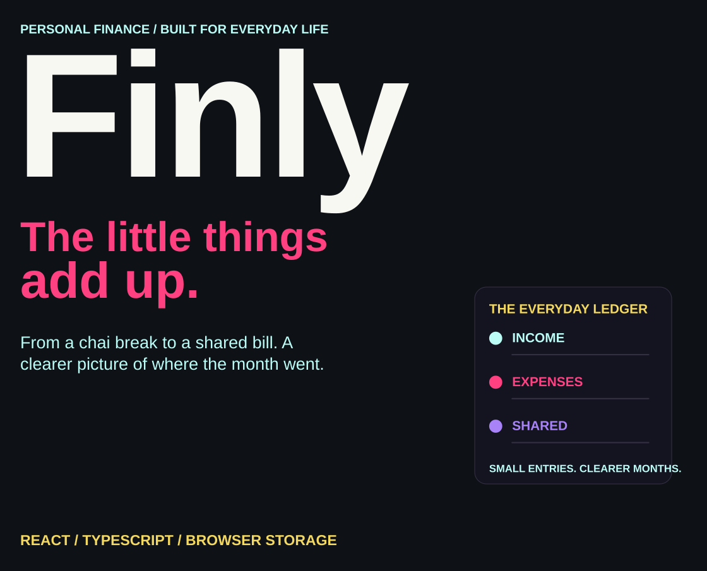</picture></p>

<p align="center"><a href="#what-i-built">Overview</a> · <a href="#a-month-in-finly">Workflow</a> · <a href="#personal-and-shared">Shared</a> · <a href="#run-locally">Run locally</a> · <a href="#storage-backups-and-pin">Storage</a> · <a href="#explore-the-source">Source</a></p>

I built Finly for the spending that happens between classes, outings and everyday plans—from a chai at a nearby café to a shared bill. It brings income, expenses, budget periods and IOUs into one browser-based workspace, with charts and exports to help me review the month.

##  What I built

<p><picture><source media="(max-width: 600px)" srcset="assets/readme/features-mobile.svg"/>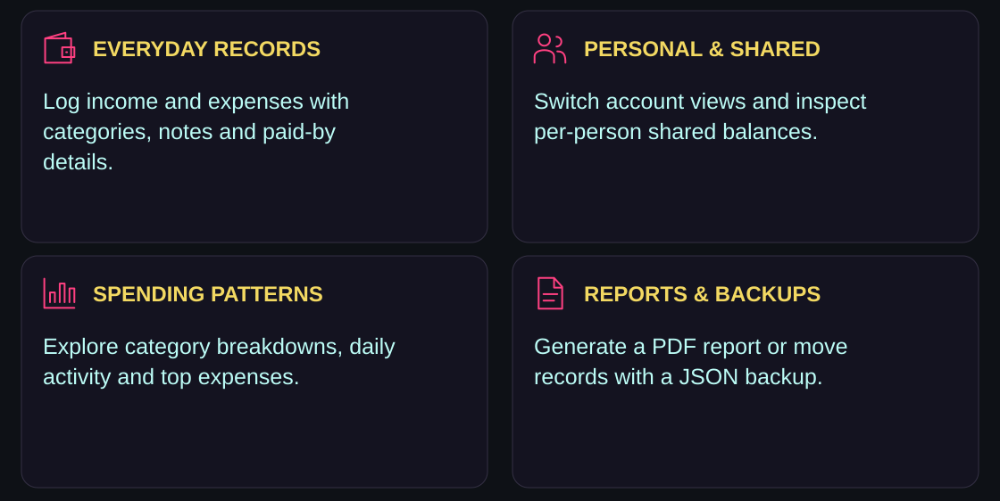</picture></p>

Transactions include a date, amount, category, description and optional notes or paid-by details. Budget periods have their own opening balances and can follow a custom timeline rather than a strict calendar month.

##  A month in Finly

<p><picture><source media="(max-width: 600px)" srcset="assets/readme/workflow-mobile.svg"/>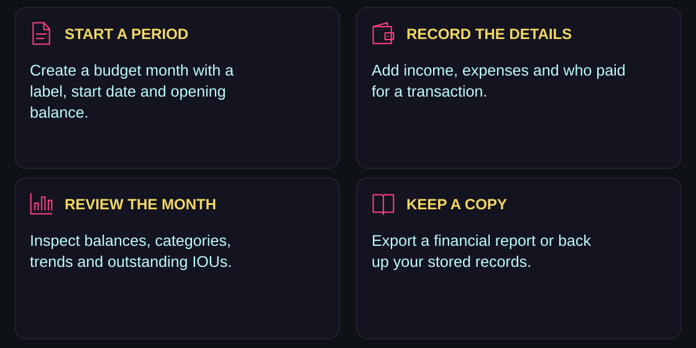</picture></p>

The dashboard summarizes income, expenses and balances for the selected period. Analytics include category charts, daily spending, trends and top expenses. The dashboard’s jsPDF export assembles a financial report with summaries, charts, transaction details, spending breakdowns and IOUs. The report is generated from your stored records; it is separate from a restorable JSON backup.

##  Personal and shared

<p><picture><source media="(max-width: 600px)" srcset="assets/readme/shared-mobile.svg"/>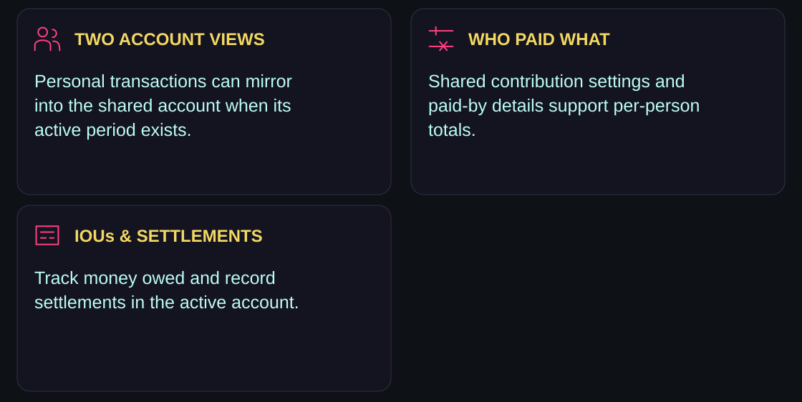</picture></p>

The current app is personalized around Adil and Snehal in shared-account attribution and contribution fields. Account labels and the displayed currency symbol can be changed in Settings; the app is not a general multi-user account service.

Personal transactions can be mirrored into an existing active shared period. Edits to those personal records update their linked mirrors. Both views use the same browser’s local store—“shared” does not mean live collaboration across devices.

IOUs record the direction of money owed and whether it has been settled. Settlement handling can add the corresponding income or expense transaction to the active account.

##  Run locally

<p><picture><source media="(max-width: 600px)" srcset="assets/readme/environment-mobile.svg"/>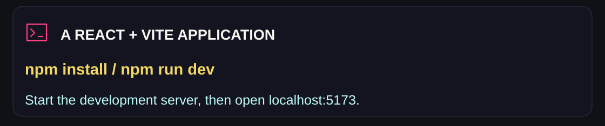</picture></p>

```bash
git clone https://github.com/adilsukumar/Finly-Personal-Finance.git
cd Finly-Personal-Finance
npm install
npm run dev
```

Open `http://localhost:5173`, or the address printed by Vite.

The current Shared-account flow asks you to create a six-digit PIN on first access. The repository contains `.env.example` with `VITE_DEFAULT_PIN`, but the current PIN implementation uses local setup and verification rather than that environment value.

### Build and project checks

```bash
npm run typecheck
npm run build
npm run preview
```

These scripts are declared in `package.json`. The build targets `dist/`; the preview server is configured for port `4173`. The repository currently has no dedicated test script.

### Stack

| Role | Technology |
|---|---|
| Application | React 18, TypeScript, Vite |
| Styling and UI | Tailwind CSS v4, Radix UI, shadcn/ui components |
| Charts | Recharts |
| Motion | Framer Motion |
| PDF reports | jsPDF |
| Persistence | Browser localStorage |

##  Storage, backups and PIN

<p><picture><source media="(max-width: 600px)" srcset="assets/readme/storage-mobile.svg"/>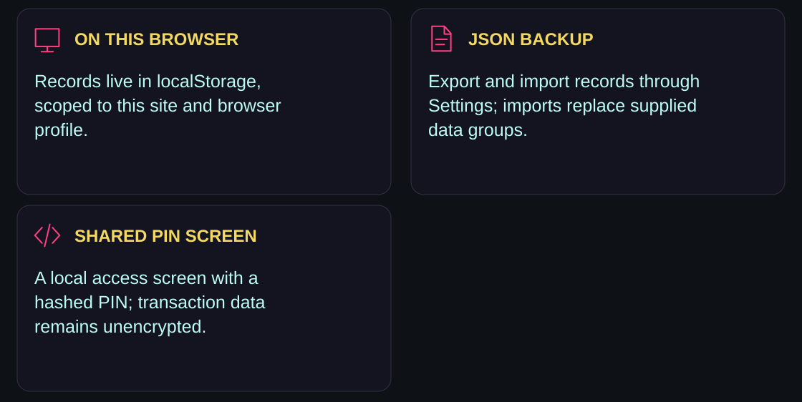</picture></p>

Financial records are stored in browser `localStorage`. This project has no application database or account-sync backend for those records. Changing the site origin, browser or device means using a different local store; clearing site data can remove your records.

Use **Settings → Export JSON** to download transactions, IOUs, budget months and settings. **Import Data** restores the supplied data groups and replaces their existing contents. The backup does not include the PIN hash or all month-prompt preferences. Keep a current backup before importing or clearing data.

The Shared-account PIN uses Web Crypto PBKDF2 with SHA-256 and 200,000 iterations. The local verification flow locks after five failed attempts for 30 minutes. This is a browser access screen, not encryption of the financial records or server-side authentication. Someone with access to the browser’s storage can inspect or alter that state.

##  Explore the source

<p align="center"><a href="src/lib/storage.ts">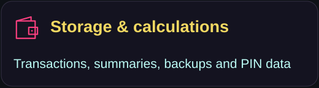</a> <a href="src/contexts/AppContext.tsx">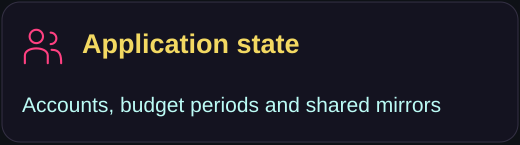</a> <a href="src/pages/Dashboard.tsx">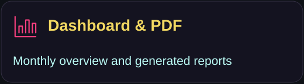</a> <a href="src/pages/Settings.tsx">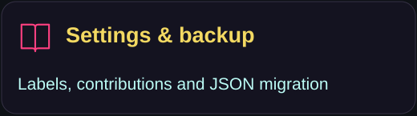</a></p>

| Area | Source |
|---|---|
| Category definitions | [categories.ts](src/lib/categories.ts) |
| Transactions | [Transactions.tsx](src/pages/Transactions.tsx) · [TransactionModal.tsx](src/components/transactions/TransactionModal.tsx) |
| Analytics | [Analytics.tsx](src/pages/Analytics.tsx) · [DashboardCharts.tsx](src/components/charts/DashboardCharts.tsx) |
| IOU management | [IOUs.tsx](src/pages/IOUs.tsx) |
| PIN interface | [PinLock.tsx](src/components/auth/PinLock.tsx) |
| Theme and app entry | [index.css](src/index.css) · [App.tsx](src/App.tsx) |

<details>
<summary><strong>Repository map</strong></summary>

```text
src/pages/                dashboard, analytics, records and settings
src/components/           UI, charts, transaction forms and PIN screen
src/contexts/             application state and account workflow
src/lib/storage.ts        local persistence and computed summaries
src/lib/categories.ts     transaction categories
src/index.css             application styling
vite.config.ts            development, build and preview configuration
```

</details>

<p><picture><source media="(max-width: 600px)" srcset="assets/readme/closing-mobile.svg"/>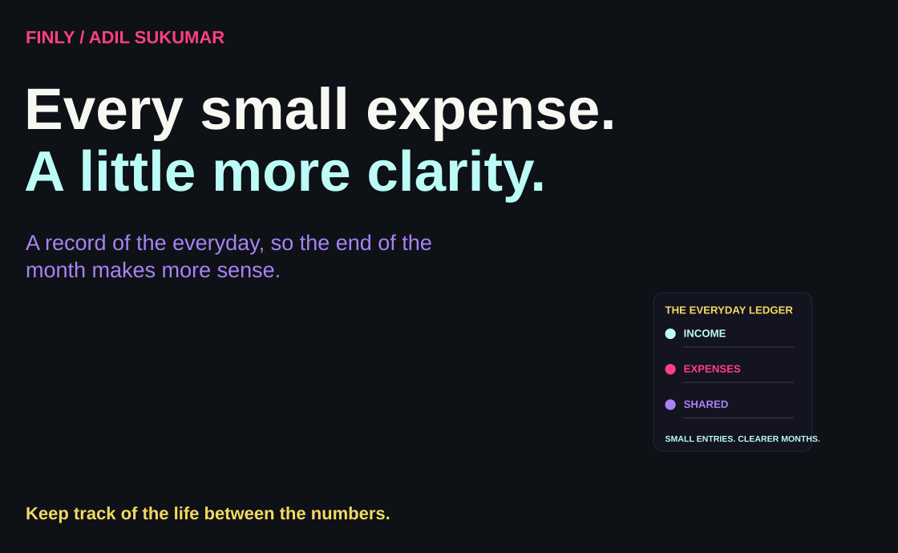</picture></p>

<p align="center"><a href="https://github.com/adilsukumar/Finly-Personal-Finance/issues">Discuss an improvement</a> · <a href="src/pages/Dashboard.tsx">Explore the dashboard</a> · <a href="https://www.adilsukumar.xyz/">Meet the builder</a></p>
